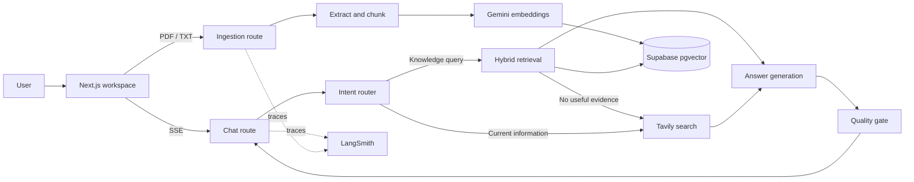

# Aperture

[](https://vercel.com/new/clone?repository-url=https%3A%2F%2Fgithub.com%2Fflaviagaglio%2Faperture-agentic-workspace)
[](https://github.com/flaviagaglio/aperture-agentic-workspace/actions/workflows/ci.yml)
[](LICENSE)

**[Live demo](https://your-demo-url.com)** — replace this placeholder with the deployed Vercel URL once a deployment is available.

Aperture is an agentic knowledge workspace for asking grounded questions about your team's documents. A LangGraph workflow routes requests to hybrid document retrieval, falls back to web research when evidence is missing or the question is time-sensitive, and checks each draft against its sources before streaming the answer.

## Technology stack

- **Application:** Next.js App Router, React, TypeScript (strict mode), and Tailwind CSS.
- **Agent orchestration:** LangGraph.js and LangChain.js, with dedicated routing, retrieval, web search, answer, and quality-check nodes.
- **Knowledge retrieval:** Supabase Postgres with pgvector, hybrid semantic and lexical search, and Gemini `gemini-embedding-001` embeddings.
- **Web research and models:** Tavily search and Google Gemini chat models.
- **Observability:** LangSmith tracing through LangChain environment configuration.
- **Delivery:** Server-Sent Events, Docker multi-stage image, and GitHub Actions CI.

## Features

- Upload PDF and TXT files, extract and chunk text, then index it for semantic and lexical retrieval.
- Ask questions in a responsive chat dashboard and follow the agent's routing, retrieval, web-search, and quality-check activity.
- Receive incremental answers over Server-Sent Events, with retrieved sources shown alongside the response.
- Route current-information requests to Tavily and fall back to web search when document evidence is not relevant enough.
- Trace graph runs with LangSmith and run the app in a production-oriented Docker container.

## Architecture



## Requirements

- Node.js 24 or newer and npm.
- A Google AI Studio API key. Gemini offers a no-cost API tier with model and usage limits; review its data-use terms before sending documents.
- A Supabase project with the SQL in `supabase/schema.sql` applied.
- A Tavily API key for web fallback (optional).
- A LangSmith API key for tracing (optional).

## Local development

1. Install dependencies:

   ```bash
   npm install
   ```

2. Copy `.env.example` to `.env.local` and set `GOOGLE_API_KEY` using a key from [Google AI Studio](https://aistudio.google.com/apikey). Add `SUPABASE_URL` and `SUPABASE_SERVICE_ROLE_KEY` for ingestion and document retrieval. Configure `TAVILY_API_KEY` and LangSmith variables when those integrations are needed.
3. In the Supabase SQL editor, run `supabase/schema.sql`.
4. Start the app:

   ```bash
   npm run dev
   ```

   Visit `http://localhost:3000`.

The Gemini API no-cost tier has rate limits and data-use terms that differ from paid plans; check Google's current [pricing and terms](https://ai.google.dev/gemini-api/docs/pricing) before using it with private documents. Without Supabase configured, document upload and retrieval are unavailable. A Google AI Studio key is required for chat and document embeddings.

## Docker

Build and run the multi-stage production image:

```bash
docker build -t aperture .
docker run --rm -p 3000:3000 --env-file .env.local aperture
```

Apply the Supabase schema before uploading documents. Provider secrets are read at runtime and must not be baked into the image.

If the database already contains documents embedded with OpenAI, re-upload those files after applying the updated schema. Gemini and OpenAI embeddings share the same vector size here but are not comparable; the search function keeps their vectors separated.

## Validation

```bash
npm run lint
npm run typecheck
npm test
npm run build
```

## API

- `POST /api/chat` accepts `{ "message": "..." }` and returns an SSE stream containing `status`, `token`, `complete`, or `error` events.
- `POST /api/documents` accepts multipart form data with a `file` field containing a PDF or TXT file (up to 10 MB; PDFs are limited to 100 pages).

## Deployment notes

This repository provides the agent and data pipeline foundation. Before exposing it as a multi-user SaaS, add an authentication provider, enforce tenant ownership in every document query and database policy, and apply per-user rate limits and usage accounting. The Supabase service-role key bypasses row-level security and must remain server-only. Review Google's free-tier data-use terms before uploading private material and configure retention, privacy, and provider data-processing policies for your deployment.

## License

MIT
