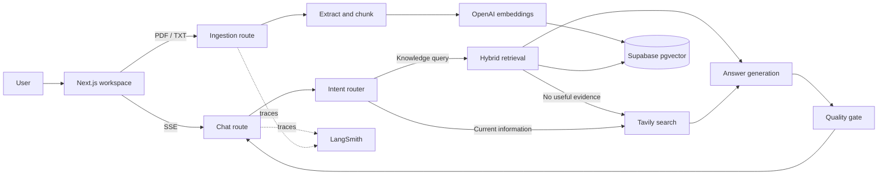

# Aperture

Aperture is an agentic knowledge workspace that answers questions from uploaded documents, falls back to web research when evidence is missing, and checks its draft against the available sources.

## Features

- LangGraph workflow for intent routing, hybrid retrieval, web fallback, answer generation, and a source-grounded quality gate.
- PDF and TXT ingestion with bounded uploads, text chunking, OpenAI `text-embedding-3-small` embeddings, and Supabase pgvector storage.
- Server-Sent Events for agent activity updates and incremental answer delivery.
- LangSmith tracing through the standard LangChain environment configuration.
- Responsive chat dashboard, Docker multi-stage image, and GitHub Actions validation.

## Architecture



## Requirements

- Node.js 24 or newer and npm.
- An OpenAI API key.
- A Supabase project with the SQL in `supabase/schema.sql` applied.
- A Tavily API key for web fallback (optional).
- A LangSmith API key for tracing (optional).

## Local development

1. Install dependencies:

   ```bash
   npm install
   ```

2. Copy `.env.example` to `.env.local` and set `OPENAI_API_KEY`. Add `SUPABASE_URL` and `SUPABASE_SERVICE_ROLE_KEY` for ingestion and document retrieval. Configure `TAVILY_API_KEY` and LangSmith variables when those integrations are needed.
3. In the Supabase SQL editor, run `supabase/schema.sql`.
4. Start the app:

   ```bash
   npm run dev
   ```

   Visit `http://localhost:3000`.

Without Supabase configured, the chat agent can still use Tavily for current-information queries, but document upload and retrieval require Supabase. Without an OpenAI key, model-powered chat and ingestion are unavailable.

## Docker

Build and run the multi-stage production image:

```bash
docker build -t aperture .
docker run --rm -p 3000:3000 --env-file .env.local aperture
```

Apply the Supabase schema before uploading documents. Provider secrets are read at runtime and must not be baked into the image.

## Validation

```bash
npm run lint
npm run typecheck
npm test
npm run build
```

## API

- `POST /api/chat` accepts `{ "message": "..." }` and returns an SSE stream containing `status`, `token`, `complete`, or `error` events.
- `POST /api/documents` accepts multipart form data with a `file` field containing a PDF or TXT file (up to 10 MB; PDFs are limited to 100 pages).

## Deployment notes

This repository provides the agent and data pipeline foundation. Before exposing it as a multi-user SaaS, add an authentication provider, enforce tenant ownership in every document query and database policy, and apply per-user rate limits and usage accounting. The Supabase service-role key bypasses row-level security and must remain server-only. Configure retention, privacy, and provider data-processing policies for your deployment.

## License

MIT
